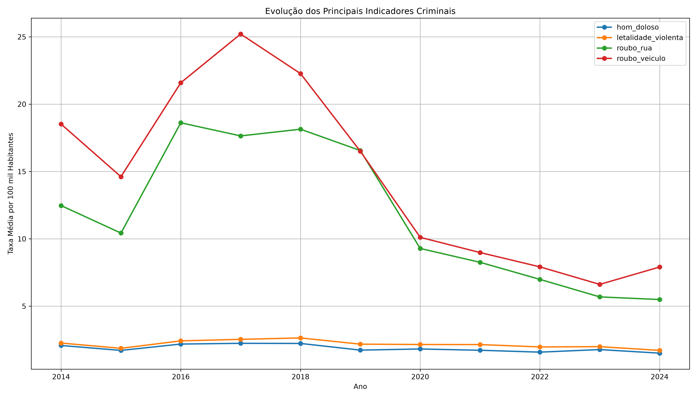
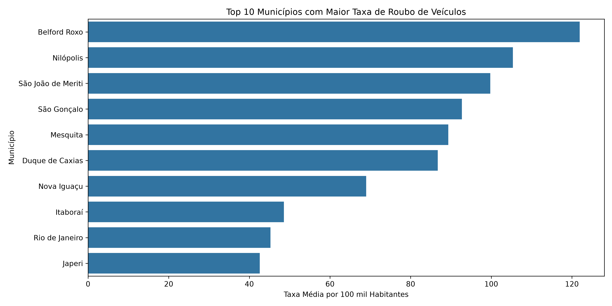
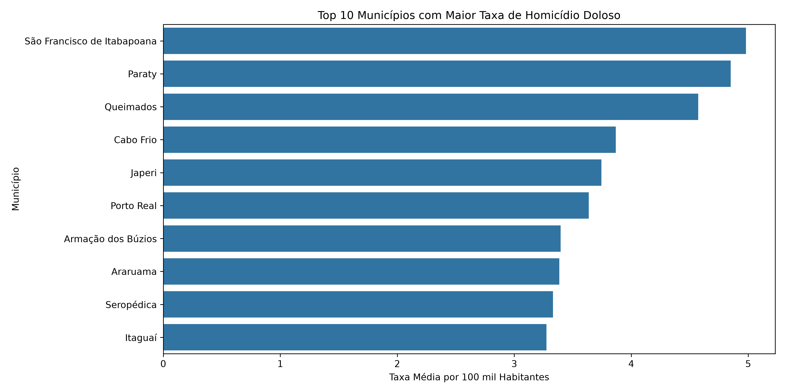
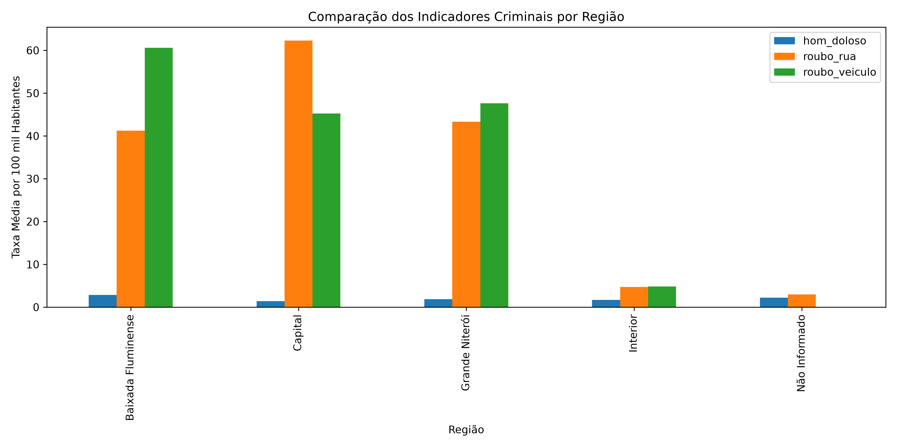
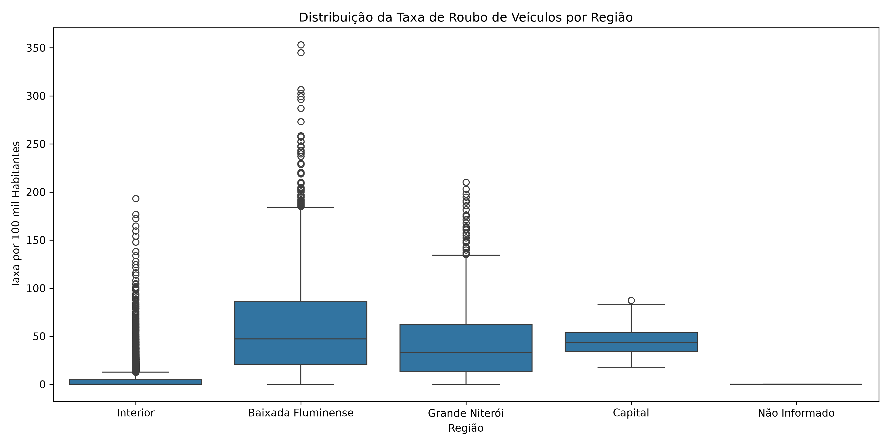
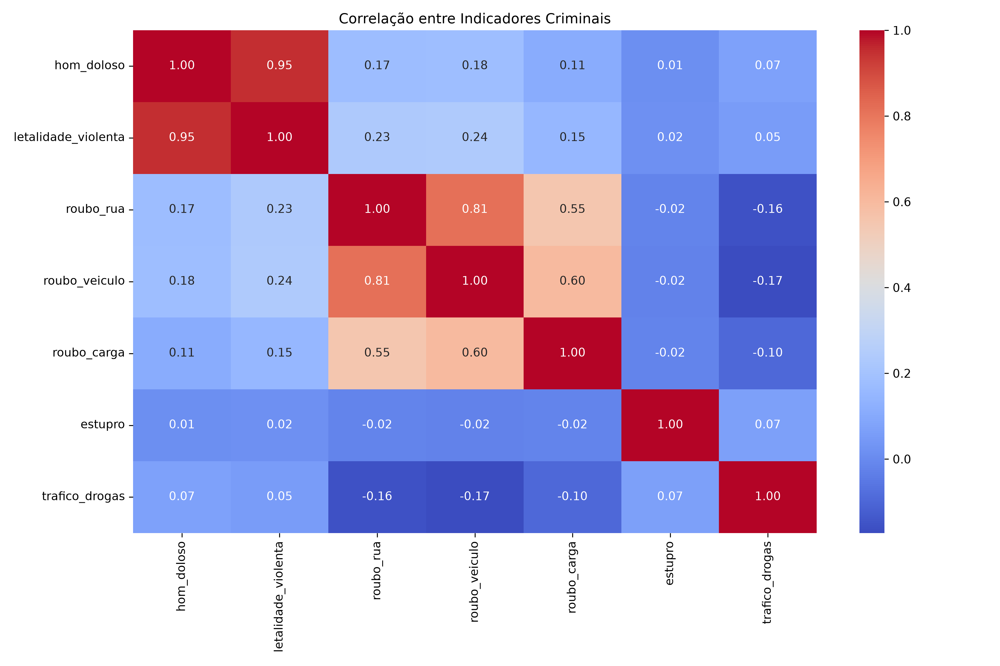
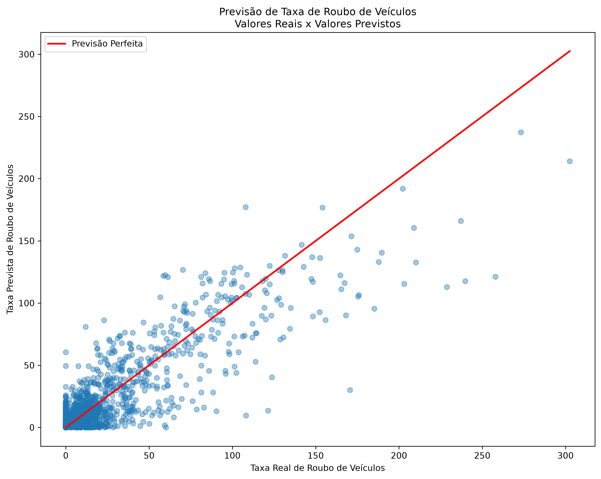

# 🚨 Análise Exploratória e Preditiva da Criminalidade no Estado do Rio de Janeiro (2014–2024)

> **Projeto de Parceria Semantix** | **Autor:** Marcos Antonio Lima da Silva
> 
> Estudo abrangente de Ciência e Análise de Dados focado na identificação de padrões temporais, disparidades regionais e modelagem preditiva com Machine Learning para apoiar a tomada de decisão em políticas públicas de segurança.

---

## 🛠️ Tecnologias e Ferramentas


---

## 🎯 Objetivos do Projeto

### 📌 Objetivo Geral
Analisar a evolução e os padrões dos principais indicadores de criminalidade nos 92 municípios do Estado do Rio de Janeiro entre 2014 e 2024, combinando **Análise Exploratória de Dados (EDA)**, **Visualização Interativa** e **Aprendizado de Máquina**.

### 🎯 Objetivos Específicos
* Tratamento e padronização da série histórica mensal (taxas por 100 mil habitantes).
* Avaliação de tendências temporais e disparidades entre regiões (Baixada Fluminense, Capital, Grande Niterói e Interior).
* Mapeamento de correlações entre diferentes categorias criminais (ex: roubo de rua vs. roubo de veículo).
* Desenvolvimento de modelo preditivo com **Random Forest Regressor** para estimar a taxa de roubo de veículos.
* Construção de dashboard interativo no Power BI para apoio ao gestor público.

---

## 🛢️ Fonte dos Dados & Processo de ETL

Os dados foram obtidos do portal de **Dados Abertos do Instituto de Segurança Pública do Rio de Janeiro (ISP-RJ)**, referentes à série histórica mensal por município (`BaseMunicipioTaxaMes.csv`).

### ⚙️ Pipeline de Tratamento em Python (`Pandas`):
1. **Padronização:** Conversão dos nomes das colunas para *snake_case*.
2. **Tratamento Temporal:** Conversão do campo `mes_ano` (formato `YYYYmMM`) para objeto `datetime`.
3. **Limpeza:** Deduplicação de registros, tratamento de nulos (`fillna()`) e padronização das variáveis regionais e de código de município.
4. **Dimensão da Base Tratada:** **12.144 registros** e **61 colunas** englobando todo o estado (2014 a 2024).

---

## 📈 Análise Exploratória & Principais Insights

### 1. Evolução Histórica dos Indicadores (2014–2024)

* Queda generalizada nas taxas de roubo de rua e de veículos a partir de 2017/2018.
* Estabilidade relativa nos indicadores de letalidade violenta e homicídio doloso em patamares inferiores aos crimes patrimoniais.

### 2. Disparidades Regionais e Municípios Críticos
* **Roubo de Veículos:** Concentração severa na Baixada Fluminense e Grande Niterói.
  * *Top Municípios:* **Belford Roxo**, **Nilópolis**, **São João de Meriti** e **São Gonçalo** lideram as taxas médias.
* **Homicídio Doloso:** Destaque para áreas do interior e regiões litorâneas.
  * *Top Municípios:* **São Francisco de Itabapoana**, **Paraty** e **Queimados**.




### 3. Comparação e Distribuição Regional



### 4. Matriz de Correlação

* **Alta Correlação Positiva ($r = 0,81$):** Forte associação entre **Roubo de Rua** e **Roubo de Veículos**, indicando a atuação conjunta de frentes criminais patrimoniais em vias públicas.
* **Correlação com Roubo de Carga ($r = 0,60$):** Roubo de veículos também dialoga fortemente com o roubo de cargas.

---

## 🤖 Machine Learning: Previsão da Taxa de Roubo de Veículos

Desenvolvimento de um modelo preditivo para estimar a taxa de roubo de veículos a partir de outros indicadores de criminalidade.

* **Algoritmo:** `Random Forest Regressor`
* **Variável Alvo:** `roubo_veiculo`
* **Variáveis Explicativas:** `hom_doloso`, `letalidade_violenta`, `roubo_rua`, `roubo_carga`, `estupro`, `trafico_drogas`.

### 📊 Desempenho do Modelo
* **Coeficiente de Determinação ($R^2$):** **`0,774`** (O modelo explica aproximadamente 77,4% da variância do roubo de veículos).
* **Erro Médio Absoluto (MAE):** **`7,55`** unidades por 100 mil hab.



### 🔑 Importância das Variáveis no Modelo
1. **Roubo de Rua (`roubo_rua`):** **69,55%** (Principal fator preditivo)
2. **Roubo de Carga (`roubo_carga`):** **12,33%**
3. **Tráfico de Drogas (`trafico_drogas`):** **5,73%**
4. **Homicídio Doloso (`hom_doloso`):** **4,18%**
5. **Estupro (`estupro`):** **4,13%**
6. **Letalidade Violenta (`letalidade_violenta`):** **4,07%**

---

## 📊 Dashboard Power BI & Relatório Executivo

O projeto conta com um **Dashboard Interativo no Power BI** e um **Relatório Técnico**, estruturados para navegação dinâmica por Município, Ano e Região, abordando:
* Visão Geral da Criminalidade e Evolução Temporal.
* Rankings Municipais e Comparativos Regionais.
* Mapeamento Geográfico e painel preditivo de Machine Learning.

---

## 📁 Estrutura de Arquivos do Repositório

```text
projeto-semantix-criminalidade-rj/
│
├── 📜 README.md                                <-- Documentação do projeto
├── 📄 Projeto Semantix.pdf                     <-- Relatório do Dashboard executivo
├── 📄 Análise da Criminalidade nos Municípios...pdf <-- Documento e relatório técnico
├── 📊 Projeto Semantix.pbix                    <-- Arquivo do Power BI
├── 💻 Projeto Semantix.py                      <-- Script consolidado do projeto
├── 💻 02_EDA.py                                <-- Script de Análise Exploratória (gráficos)
├── 💻 03_ML.py                                 <-- Script do modelo de Machine Learning
├── 🛢️ BaseMunicipioTaxaMes_Limpa.csv            <-- Base de dados tratada (2014-2024)
│
├── 🖼️ 01_evolucao_criminalidade.png           <-- Gráfico de evolução temporal
├── 🖼️ 02_top10_roubo_veiculo.png              <-- Gráfico ranking roubo de veículo
├── 🖼️ 03_top10_homicidios.png                 <-- Gráfico ranking homicídios
├── 🖼️ 04_comparacao_regioes.png               <-- Gráfico comparativo regional
├── 🖼️ 05_heatmap_correlacao.png               <-- Matriz de correlação
├── 🖼️ 06_boxplot_roubo_veiculo.png            <-- Boxplot de distribuição regional
└── 🖼️ real_vs_previsto.png                    <-- Validação do modelo Random Forest
